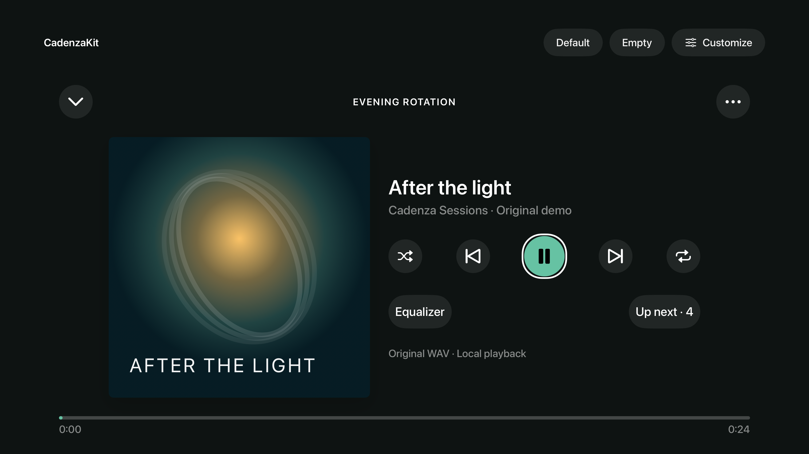

# Customizable SwiftUI player

Select the optional **CadenzaSwiftUI** product. It depends on CadenzaDomain and the
UI-independent **CadenzaPresentation** snapshot projection. CadenzaKit and its
playback backends do not depend on SwiftUI. Supports iOS/iPadOS
17+, macOS 14+, and tvOS 17+.

The view receives a `PlayerContext`: a snapshot of SDK state, presentation data,
and host action handlers. It does not create an engine, own a queue, persist state,
or bypass service-layer feature/capability checks. Refresh its state when your
presentation model receives new SDK snapshots.

```swift
import SwiftUI
import CadenzaDomain
import CadenzaSwiftUI

struct HostPlayer: View {
    let snapshot: PlaybackSnapshot
    let playPause: () -> Void

    var body: some View {
        CadenzaPlayerView(context: PlayerContext(
            state: PlayerState(snapshot: snapshot),
            actions: PlayerActions(controls: [.playPause: playPause])
        ))
    }
}
```

Handlers should call your SDK-backed presentation model and surface any errors.
Missing handlers hide optional controls and disable essential transport controls.
The UI cannot authorize an unavailable source, output, backend, or feature.

## Defaults and customization

All built-in appearance values have defaults in `PlayerAppearance`. Change them
individually without copying the layout:

```swift
var appearance = PlayerAppearance()
appearance.fonts.title = .system(size: 28, weight: .medium, design: .rounded)
appearance.metrics.iconSize = 22
appearance.light.accent = .orange
appearance.dark.accent = .yellow
appearance.light.onAccent = .black
appearance.metrics.primarySize = 72
appearance.metrics.primaryRadius = 16
appearance.metrics.spacing = 20
```

Light/dark palettes, typography, spacing, padding, artwork bounds/aspect ratio,
corners, shadows, control sizes and responsive layout thresholds are configurable.
Fonts are SwiftUI `Font` values, so hosts can use system or their own bundled fonts.
Use `.vertical`, `.horizontal` or `.automatic` for `arrangement`.

Replace icon images, including Play and Pause, with assets in **your** bundle:

```swift
let images = PlayerImages { icon in
    switch icon {
    case .play: Image("MyPlayAsset", bundle: .main).resizable()
    case .pause: Image("MyPauseAsset", bundle: .main).resizable()
    default: Image(systemName: icon.systemName)
    }
}
```

Replace every static and accessibility label using `PlayerStrings.resolve` and
replace time formatting using `PlayerStrings.time`. Defaults use the SDK's
English/German localization resources. Track titles, subtitle, context and footer
come from host data; no sample artists, durations, route names or quality claims
are embedded in the SDK UI.

```swift
let strings = PlayerStrings(
    resolve: { key in key == .play ? "Start listening" : PlayerStrings.localized(key) },
    time: { seconds in "\(Int(seconds))s" }
)
```

## Replace components or the entire layout

Design tokens are conveniences, not limits. `PlayerComponents` can replace the
background, header, artwork, metadata, progress control, transport, accessories
or footer with arbitrary SwiftUI views:

```swift
var components = PlayerComponents()
components.set(.artwork) { _ in
    Image("AlbumCover", bundle: .main).resizable().scaledToFit()
}
components.setButton { button in
    Button(action: button.perform) {
        Text(button.label).font(.headline).padding()
    }
    .disabled(!button.enabled)
    .accessibilityLabel(button.label)
}
```

The button context includes its role, current icon (including Play/Pause),
selection state, availability, label and action. A custom button owns its own
colors, dimensions, shape, focus/pressed feedback and accessibility. The same
applies to custom sections; preserve useful labels, touch targets and TV focus.

For complete layout ownership, use `components.setLayout { context in ... }`.
This replaces all SDK chrome, sizing and styling. Alternatively,
`CadenzaPlayerView(context: context, layout: .empty)` renders **nothing**: no
placeholder, controls, background or padding. Compose your own views around the
same state/actions. Switching layouts does not change the playback session.

The SDK includes no artwork, fonts, audio or icon packs. SF Symbols are the default
icons; hosts provide media visuals. The default player uses a compact artwork-led
layout or a wide artwork/detail arrangement, with system accessibility and focus
behavior. tvOS exposes progress as a read-only indicator; replace the progress
component to add a host-specific remote scrubbing interaction.

## Seeking

The default slider previews the thumb position and elapsed-time label locally
while dragging. Playback snapshots continue updating without moving that preview.
Releasing the slider calls `PlayerActions.seek` once with the final bounded target;
a drag does not issue a backend seek for every intermediate value. A target from
a different track is discarded. tvOS retains its read-only progress indicator.

Keep action handlers installed during transient operations: a missing handler
means a control is unavailable, and optional controls disappear. Serialize commands
in your presentation/service layer. Hosts needing continuous scrubbing can replace
`.progress` and use `positionBinding(_:)`, which dispatches every binding update.

The slider retains its released thumb position until the next playback snapshot,
then resumes tracking the backend. Late value callbacks cannot issue another seek.
Accessibility adjustments use `PlayerMetrics.seekIncrement` (five seconds by
default), clamped to the media duration, and do not leave a drag preview active.

## Appearance and TV focus

The entire default player follows SwiftUI's `colorScheme`. Configure
`PlayerAppearance.light` and `.dark` independently, or apply
`.preferredColorScheme(.dark)` to your host presentation. The showcase's Customize
panel includes persistent System, Light, and Dark choices.

On tvOS, default icons are 36 points, control targets are 80 points, and the
primary control is 96 points. A focus outline keeps the focused control distinct
without replacing its foreground with a system highlight color. Customize
`focusRing`, `controlBackground`, `progressTrack`, `focusRingWidth`,
`focusRingPadding`, `controlHorizontalPadding`, and `progressHeight` alongside
the existing size and color tokens. Custom button builders remain fully replaceable.


TV appearance captures from the running example app:

| Light | Dark |
| --- | --- |
|  |  |

## Measured audio spectrum

`CadenzaSpectrumView(frame:)` renders the 32 measured bands in a `SpectrumFrame`.
It has no playback engine or timer. Supply frames from the same `CadenzaPlayer`
that owns playback, with `FeatureFlags(spectrum: true)` and an
`AVAudioEngineBackend`:

```swift
@State private var frame = SpectrumFrame()

CadenzaSpectrumView(frame: frame, color: .mint, spacing: 3,
                    cornerRadius: 2, minimumBarHeight: 2,
                    accessibilityTitle: "Audio spectrum")
    .frame(height: 64)
    .task {
        defer { player.stopSpectrum() }
        do {
            while !Task.isCancelled {
                frame = try await player.readSpectrum()
                try await Task.sleep(for: .milliseconds(33))
            }
        } catch is CancellationError {
            frame = SpectrumFrame()
        } catch {
            frame = SpectrumFrame()
            // Present the structured capability error in host UI.
        }
    }
```

Use one sequential sampling task per player, sharing its frames between views.
Cancel the task when the view is hidden/backgrounded or motion is reduced, and
clear the displayed frame. `readSpectrum()` selects the current queue provider,
returns silence when playback is inactive/backgrounded, and rejects revoked or
unsupported capabilities. Transport changes invalidate pending reads. Forward
host lifecycle through `player.setBackgrounded(_:)` as usual.

The view automatically respects the system Reduce Motion setting. Hosts can also
force a static baseline with `reducesMotion: true`. No implicit animation is
applied: bar heights follow incoming frames at the host's sample cadence. The
entire graph is one accessibility image with a localized, overridable label;
individual bars do not generate VoiceOver announcements. Place a separate text
status beside the graph if the host needs to announce playing/paused state.
Height is set with standard view modifiers; tint, spacing, corner radius and
minimum bar height are configurable. No fonts, artwork or media are bundled.

The demo displays the same SDK view in the player footer and EQ panel, sharing
one sampler and the playback engine. Its native audio is generated by the demo.
See [analysis semantics and backend limitations](Integration.md#audio-spectrum-analysis).
