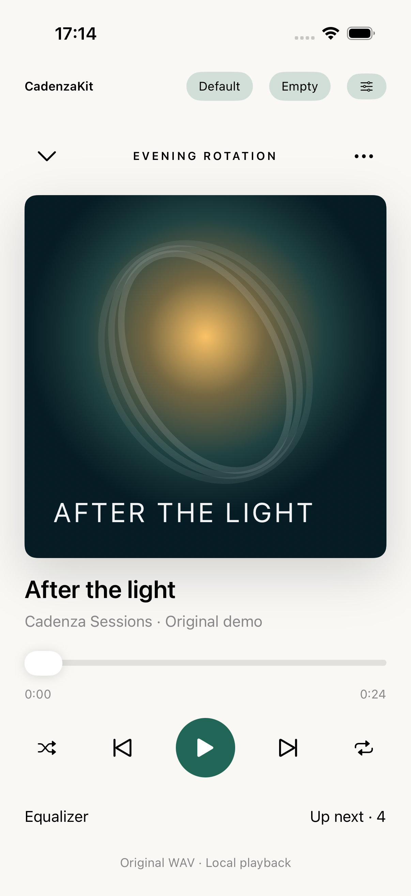
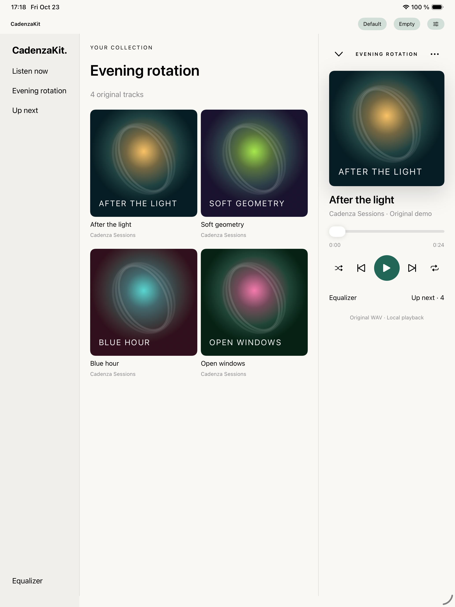
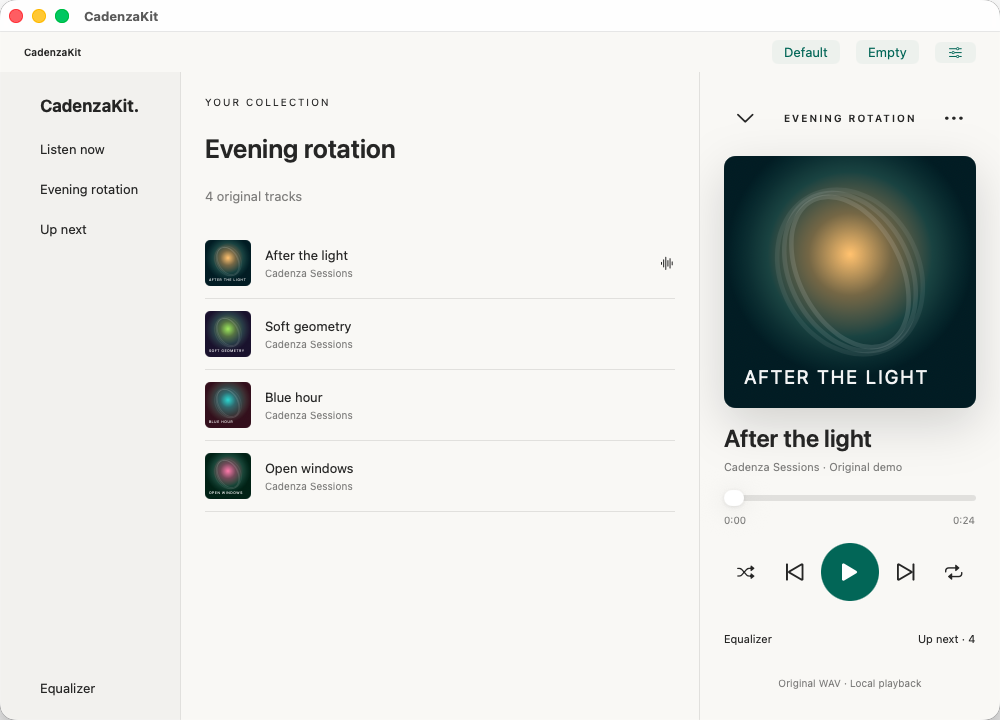
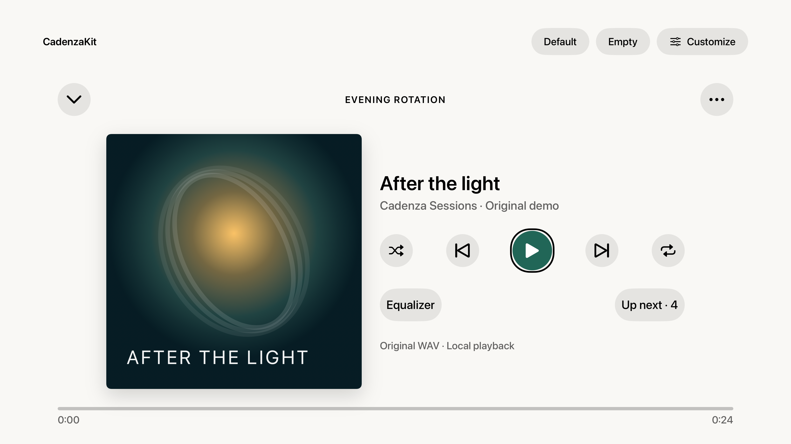

# CadenzaKit

**Your music player. Your UI.**

A modular Swift music-player SDK for iOS/iPadOS 17+, macOS 14+, and tvOS 17+.
Compose local or HTTPS playback, queues, playlists, bookmarks, artwork, offline
storage, and native equalization through independently selectable package products.
Your app owns the UI; the SDK owns playback and service logic.

[Integration guide](Documentation/Integration.md) · [Xcode example apps](Examples/CadenzaDemo) · [Build and test](Documentation/Testing.md)

Optional [SwiftUI components](Documentation/SwiftUI.md) provide configurable defaults
and full component/layout replacement without coupling UI to playback services.

## Usage

Add `https://github.com/muh-bilal/CadenzaKit` in Xcode's **Add Package Dependencies**
using the `main` branch. For the simplest integration, select `CadenzaPlayer` and `CadenzaDomain`. Requires Swift 6.

```swift
import CadenzaDomain
import CadenzaPlayer

// Run on MainActor and retain at app scope. fileURL is an accessible audio URL.
let source = MediaSource { id in
    MediaResource(id: id, url: fileURL, title: "My track")
}
let player = try CadenzaPlayer(source: source)
try await player.play(MediaID("track"))
// Progress and queue advancement are automatic; UI is optional.
```

The facade updates progress and advances the queue automatically. Call `stop()`
when finished; lower-level services remain available for custom orchestration. See the
[integration guide](Documentation/Integration.md) for feature flags, optional
products, persistence, capability checks, and complete usage examples.

Open `Examples/CadenzaDemo/CadenzaDemo.xcodeproj` and select `CadenzaiOS`
(iPhone/iPad), `CadenzamacOS`, or `CadenzatvOS`. Each app uses this checkout's
CadenzaKit package for playback, queue behavior, saved positions and equalization.
Choose **Default** for the supplied player layout, **Empty** for a blank SDK view,
or **Customize** to change fonts, colors, assets, labels and button implementations.

## Screenshots

Actual Xcode example apps using the Default layout and original demo media.

<table>
<tr><th>iPhone</th><th>iPad</th></tr>
<tr>
<td align="center"></td>
<td align="center"></td>
</tr>
<tr><th>Native Mac</th><th>Apple TV</th></tr>
<tr>
<td></td>
<td></td>
</tr>
</table>
The SDK and demos are under development. The player facade enables background audio and system Now Playing metadata/controls through `systemPlayback: true`.
[Detailed capabilities and limitations](Documentation/Integration.md)
