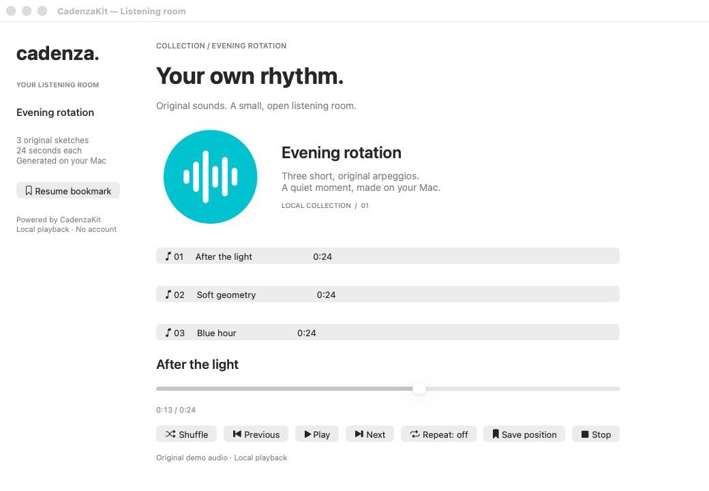
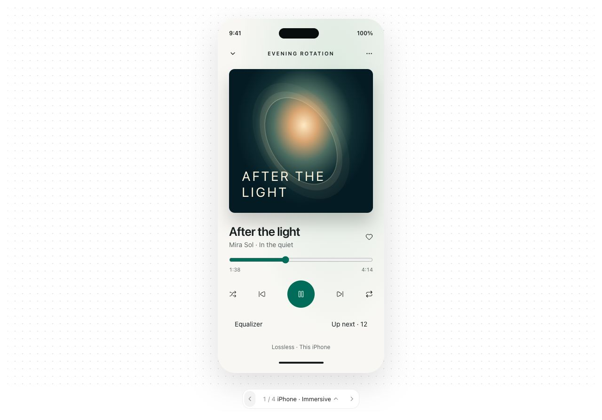
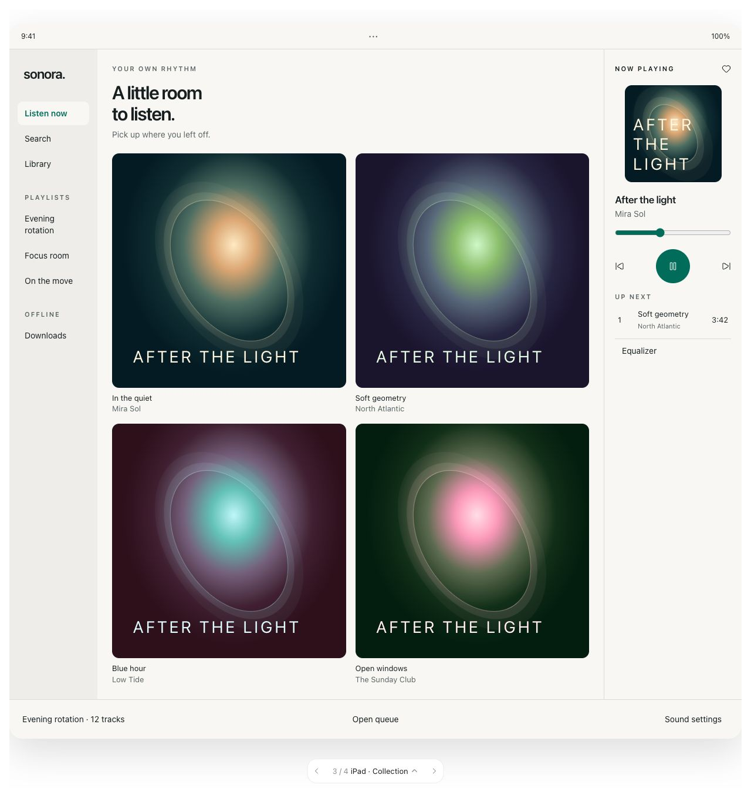
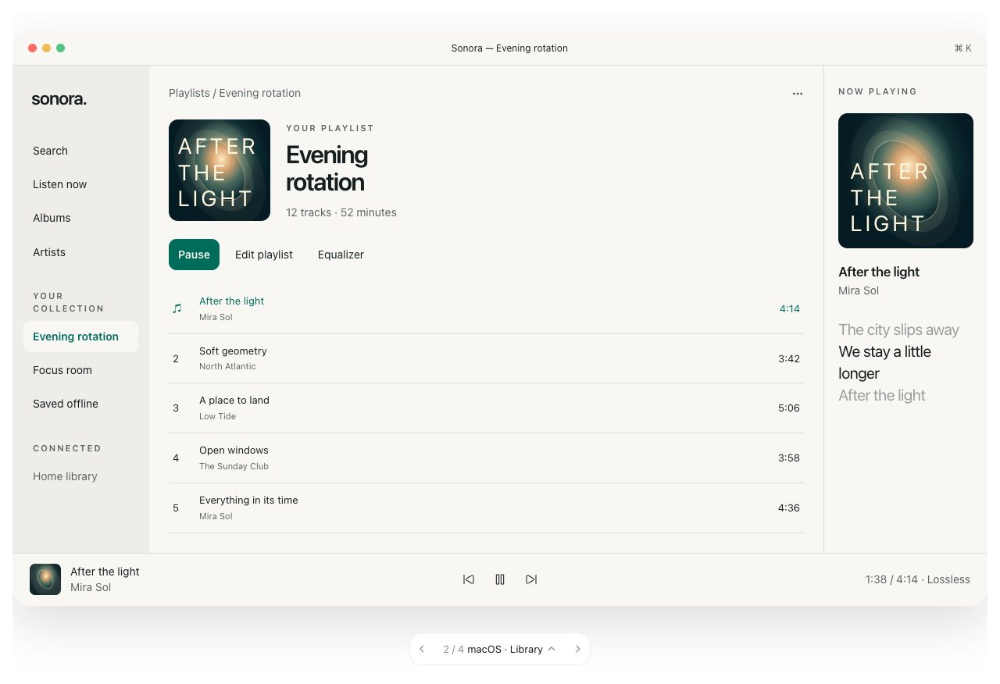
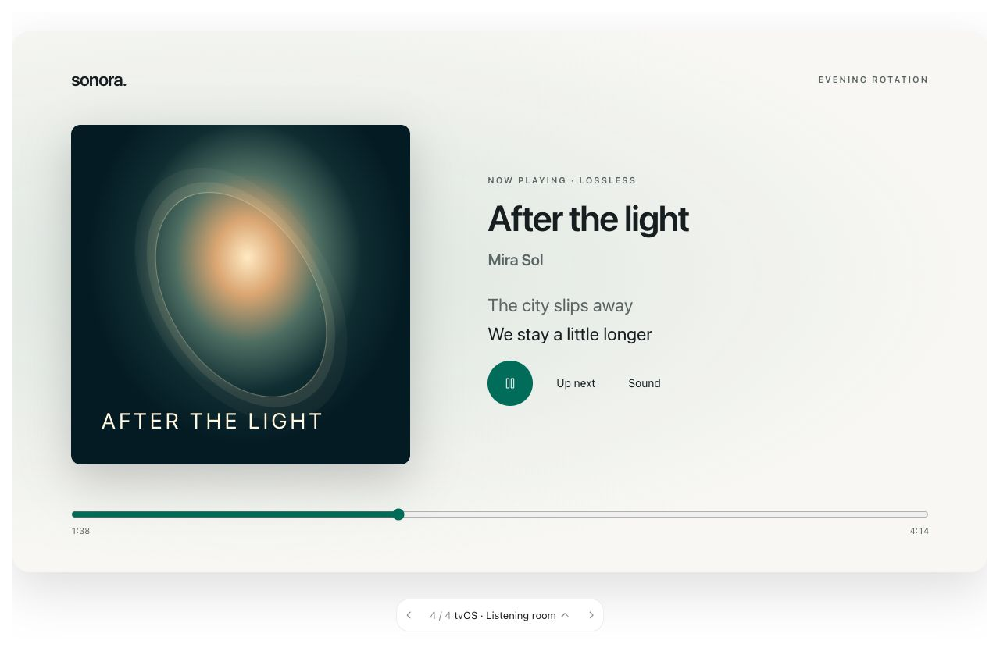

# CadenzaKit

**Your music player. Your UI.**

A modular Swift music-player SDK for iOS/iPadOS 17+, macOS 14+, and tvOS 17+.
Compose local or HTTPS playback, queues, playlists, bookmarks, artwork, offline
storage, and native equalization through independently selectable package products.
Your app owns the UI; the SDK owns playback and service logic.

[Integration guide](Documentation/Integration.md) · [Xcode example apps](Examples/CadenzaShowcase)

## Usage

Add `https://github.com/muh-bilal/CadenzaKit` in Xcode's **Add Package Dependencies**
using the `main` branch. For local playback, select `CadenzaKit`, `CadenzaDomain`,
`CadenzaLocalSources`, and `CadenzaAVPlayback`. Requires Swift 6.

```swift
import Foundation
import CadenzaDomain
import CadenzaKit
import CadenzaLocalSources
import CadenzaAVPlayback

@MainActor
func playFile(_ url: URL) async throws -> PlaybackSession {
    let media = MediaResource(id: try MediaID("track"), url: url, title: "My track")
    let source = try LocalFileSource(resources: [media.id: media])
    let kit = try Cadenza(
        configuration: .init(defaultProvider: source.identifier),
        providers: [source]
    )
    let player = kit.makeSession(backend: AVPlayerBackend())
    try await player.load(media.id)
    try await player.play()
    return player
}
```

Pass an accessible local audio URL and retain the returned session. Your app drives
`refresh()` for progress/EOF and calls `stop()` when finished. See the
[integration guide](Documentation/Integration.md) for feature flags, optional
products, persistence, capability checks, and complete usage examples.

Open `Examples/CadenzaShowcase/CadenzaShowcase.xcodeproj` and select `CadenzaiOS`
(iPhone/iPad), `CadenzamacOS`, or `CadenzatvOS`. Each app uses this checkout's
CadenzaKit package for playback, queue behavior and saved positions.

The standalone macOS package demo is also available:

```sh
swift run --package-path Examples/CadenzaDemo CadenzaDemo
```

## Screenshots

**Working macOS demo** — real playback, queue controls, and persistent bookmarks.



**Design concepts** — illustrative prototypes, not screenshots of shipped platform
apps. The “Sonora” name is placeholder branding.

<table>
<tr><th>iPhone concept</th><th>iPad concept</th></tr>
<tr>
<td align="center"></td>
<td align="center"></td>
</tr>
<tr><th>Mac concept</th><th>Apple TV concept</th></tr>
<tr>
<td></td>
<td></td>
</tr>
</table>

The SDK and demos are under development. System playback integration is not implemented.
[Detailed capabilities and limitations](Documentation/Integration.md)
